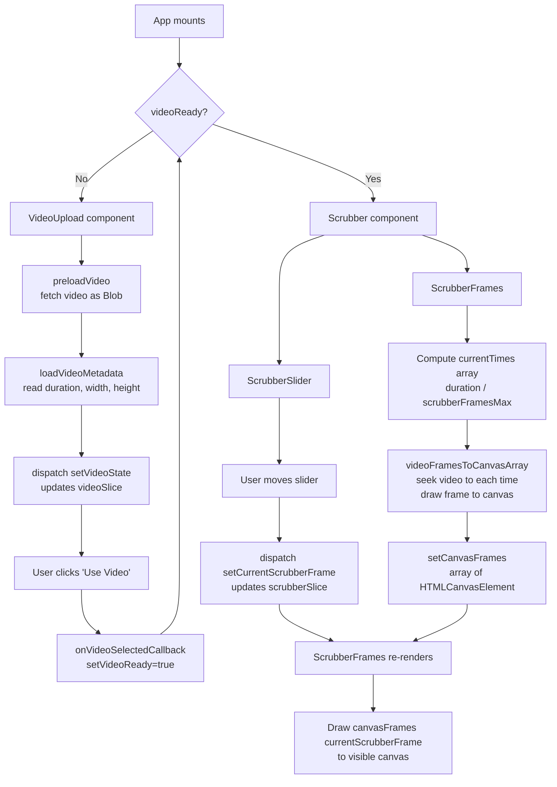

# React Video Scrubber
This React component is a locally-based solution for generating still frames from a video source. This method is an alternative to a server-side, Node.js/FFmpeg solution where video frames would be extracted and returned to the client as a sequence of images.


# Scrub Video Frames using Array of Canvas Elements

## Application Logic Flow

The diagram below illustrates the high-level data and component flow of the application, from initial video load through frame extraction and user-driven scrubbing.



### Flow Summary

1. **Load** &mdash; `VideoUpload` preloads the source video as a Blob and reads its metadata, then dispatches it into the Redux `videoSlice`.
2. **Confirm** &mdash; Once the user confirms the video, `App` swaps `VideoUpload` for the `Scrubber`.
3. **Extract Frames** &mdash; `ScrubberFrames` calculates evenly-spaced time offsets and uses `videoFramesToCanvasArray` to seek a hidden `<video>` element to each offset, drawing the result into an array of `<canvas>` elements.
4. **Scrub** &mdash; `ScrubberSlider` dispatches the current frame index to the `scrubberSlice`; `ScrubberFrames` listens for changes and paints the matching cached canvas into the visible canvas.

## Running Locally

Make sure you have [Node.js](http://nodejs.org/) installed.

```sh
git clone https://github.com/patrick-s-young/react-video-scrubber.git # or clone your own fork
cd react-video-scrubber
yarn install
yarn start
```

## Built With

* [React](https://react-cn.github.io/react/downloads.html) - JavaScript UI library.
* [Redux Toolkit](https://redux-toolkit.js.org/) - Opinionated, batteries-included toolset for efficient Redux development.
* [TypeScript](https://www.typescriptlang.org/) - Extends JavaScript by adding types to the language.
* [webpack](https://webpack.js.org/) - Static module builder.

## Authors

* **Patrick Young** - [Patrick Young](https://github.com/patrick-s-young)

## License

This project is licensed under the MIT License - see the [LICENSE](LICENSE) file for details.
